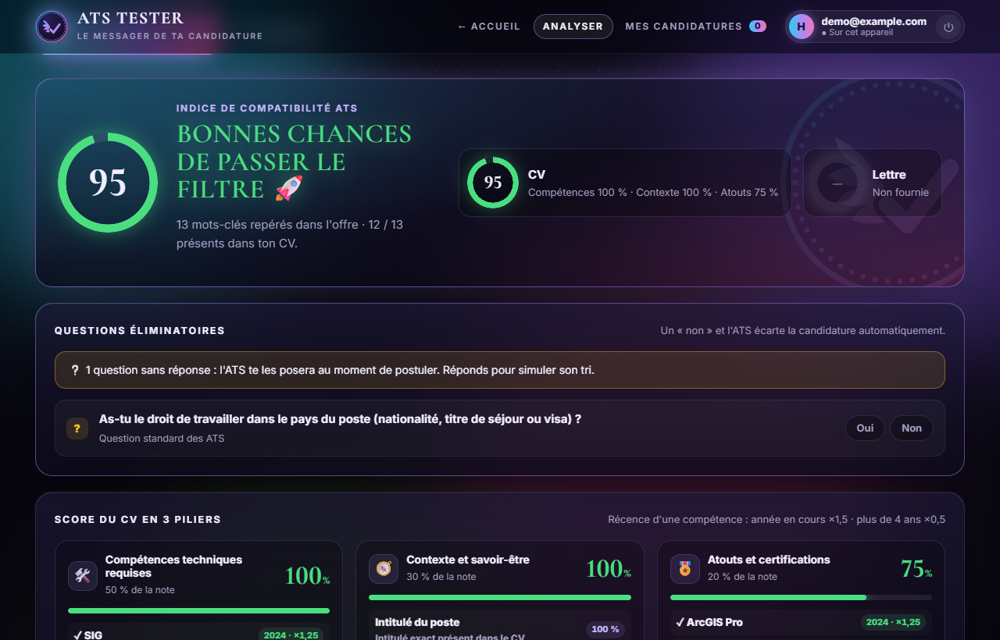
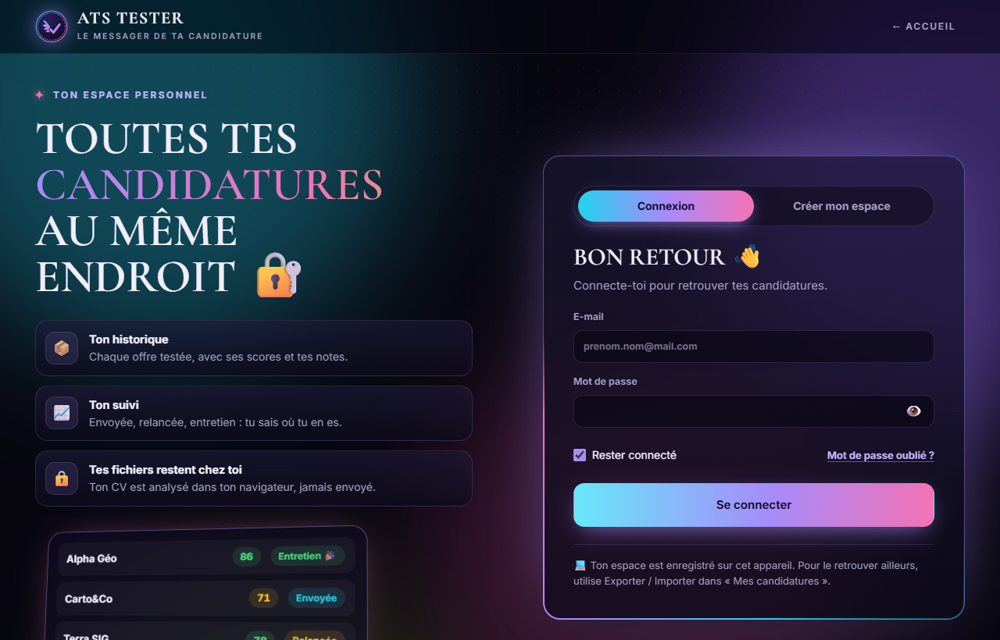

<p align="center"></p>

# ATS Tester

*Le messager de ta candidature.*

**Teste ton CV et ta lettre de motivation face à une fiche de poste, comme le ferait un logiciel de recrutement (ATS), avant de les envoyer.**

🔗 **Démo en ligne :** https://hermes-bit.github.io/ats-tester/



## Pourquoi ?

La plupart des entreprises trient les candidatures avec un ATS (*Applicant Tracking System*). Ce logiciel lit le texte du CV, cherche les mots-clés de l'offre et écarte les candidatures qui ne correspondent pas, parfois avant qu'un recruteur les voie. Cette application simule ce filtre pour t'aider à corriger tes documents à temps.

## Fonctionnalités

- **Import de la fiche de poste** : texte collé, PDF, DOCX, TXT, Markdown, HTML ou RTF.
- **Import du CV et de la lettre** : PDF, DOCX, TXT…, ou texte collé.
- **Analyse des mots-clés** : compétences, logiciels, formats de données, méthodes et savoir-être repérés dans l'offre, puis recherchés dans le CV et la lettre. La recherche ignore les accents, les majuscules et les pluriels, et reconnaît les synonymes (ex. *FME Server* = *FME Flow*, *SIG* = *GIS*).
- **Distinction obligatoire / « un plus »** : les compétences marquées « est un plus » ou « serait appréciée » pèsent moins dans le score.
- **Vérifications ATS** : texte lisible (PDF scanné ?), coordonnées, rubriques standards, intitulé du poste, longueur, dates, tableaux et images, **ligatures typographiques** (« Shapefile » lu « Shape fi le »), lettres isolées.
- **Vérifications de la lettre** : nom de l'entreprise, intitulé du poste, longueur, formule d'appel, formule de politesse, objet.
- **Lecture structurée du CV**, comme un vrai ATS : nom, e-mail validé, téléphone au format international (E.164), ville, expériences (intitulé, entreprise, dates, **durée en mois calculée**, poste actuel), formations (**niveau normalisé** Bac+2 à Bac+8), compétences (**année du dernier usage** et contexte). Les intitulés de poste sont normalisés (« VP Sales », « Directeur commercial », « Head of Sales » → `SALES_DIRECTOR` ; « Géomaticien », « Chargé d'études SIG » → `GIS_ANALYST`). Ce qui ne peut pas être découpé est gardé tel quel (`unparsed_rich_text`) et reste cherchable.
- **Questions éliminatoires** : autorisation de travail, permis, diplôme exigé, années d'expérience minimum, langues, habilitation. Un « non » fait passer la candidature à `DISQUALIFIED_AUTO`, comme dans un vrai ATS. Elle reste enregistrable avec le statut de ton choix et porte l'étiquette **« ⛔ Pré-requis bloquant »** dans « Mes candidatures » ; un critère sans réponse affiche « ❔ Pré-requis à vérifier ». Les réponses sont modifiables dans le détail de la candidature, un filtre « Pré-requis bloquant » les regroupe, et un webhook (Zapier, Make, n8n…) peut être prévenu.
- **Score en 3 piliers** pour le CV (voir plus bas), un score pour la lettre et un indice global, avec des **recommandations** classées par priorité.
- **« Ce que voit l'ATS »** : le texte brut extrait, dans l'ordre de lecture, avec les mots-clés trouvés surlignés.
- **Prompt pour ton IA générative** : un prompt prêt à copier dans ChatGPT, Claude, Gemini, Le Chat ou Copilot. Il reprend la fiche de poste, tes documents, les scores, les mots-clés manquants et les problèmes détectés. Deux modes :
  - **Retouches, en gardant ma mise en page** (par défaut) : l'IA propose des remplacements de texte précis (emplacement, texte actuel, nouveau texte), de même longueur, à reporter dans ton fichier d'origine. La charte graphique de ton CV et de ta lettre reste intacte.
  - **Réécriture complète** : l'IA réécrit le CV et la lettre en texte structuré.

  Dans les deux cas, l'IA n'invente rien et te pose des questions sur les compétences qui manquent. Une option masque ton e-mail et ton téléphone avant le partage.
- **Espace personnel** : chacun se connecte avec son e-mail et un mot de passe et retrouve ses propres candidatures. Les candidatures enregistrées avant la création des espaces sont proposées à la récupération lors de la première connexion. Voir [Espaces personnels](#espaces-personnels).
- **Temps de réflexion** : pendant l'analyse, une fenêtre montre les étapes une à une (lecture, mots-clés, comparaison, contrôles, recommandations) avec les vrais chiffres.
- **Suivi des candidatures** : sauvegarde de chaque candidature (entreprise, poste, date, statut, notes, scores, fiche de poste, textes envoyés et profil lu par l'ATS), filtres par statut, archives et statistiques.
- **CV et lettre de chaque candidature téléchargeables** : le fichier d'origine (PDF, DOCX…) est gardé dans le navigateur avec la candidature, puis retéléchargeable depuis « Mes candidatures » (boutons dans la liste et dans le détail). C'est toujours le fichier d'origine de la dernière analyse enregistrée pour l'offre, avec sa mise en page et sa charte graphique : rien n'est reconstruit. Un même CV utilisé pour plusieurs offres n'est gardé qu'une fois. Si le fichier d'origine manque (candidature plus ancienne, texte collé, autre appareil), le bouton devient « joindre » ; importer le document dans l'analyseur ou via « Retrouver mes fichiers » le rattache automatiquement à toutes les candidatures enregistrées avec ce même document (même texte lu). Les fichiers ne sont jamais envoyés sur un serveur : en mode cloud, ils restent sur l'appareil où ils ont été importés. L'export JSON les inclut, pour passer d'un appareil à l'autre.
- **Recherche booléenne** : `QGIS AND (Rennes OR Nantes) NOT stage`, `ET` / `OU` / `SAUF`, `-mot`, `"expression exacte"` et champs (`entreprise:`, `poste:`, `statut:`, `offre:`, `cv:`, `competences:`, `notes:`).
- **Nouvelle offre** : un bouton vide l'offre, la lettre et les résultats en gardant ton CV, pour enchaîner les candidatures. Le formulaire s'ouvre toujours vide : rien n'est gardé d'une visite à l'autre.
- **Export / import JSON** pour sauvegarder tes candidatures ou les transférer sur un autre ordinateur.
- **Confidentialité** : l'analyse se fait **dans le navigateur**. Aucun fichier n'est envoyé sur un serveur. En mode cloud, seules les candidatures que tu enregistres (avec le texte de l'offre et de tes documents) sont synchronisées dans ton espace.
- Interface responsive (ordinateur et mobile), avec un bouton « Retour » sur chaque page (Mes candidatures revient d'abord à l'analyseur) et un bouton pour remonter en haut de page, en bas à droite et dans le pied de page.

## Identité visuelle

Le site compte trois pages :

- **`index.html`** : la page publicitaire de l'outil, présentée par son créateur (accroche avec portrait, fonctionnalités, démo avant / après, chiffres, méthode, créateur).
- **`connexion.html`** : l'écran de lancement (logo animé, chargement jusqu'à 100 %), puis la connexion ou la création d'un espace.


- **`analyser.html`** : le testeur lui-même, réservé aux personnes connectées (analyse, prompt pour l'IA, suivi des candidatures). `analyser.html#candidatures` ouvre directement l'historique.

Style « néon fun » :

- **Ambiance** : nuit profonde, aurore de couleurs animée, panneaux en verre dépoli, bandeau défilant, badge rotatif, confettis quand une candidature passe le filtre.
- **Écran de lancement** : la pièce tombe et rebondit, la coche se dessine, l'aile bat, des icônes tournent autour, les lettres d'ATS TESTER arrivent une à une, puis la pièce explose en confettis à 100 % et l'écran s'ouvre en cercle sur la connexion.
- **Mise en page** : les blocs occupent toute la largeur de l'écran (jusqu'à 1880 px). Sur téléphone, les champs font 16 px pour éviter le zoom automatique de Safari, et rien ne dépasse sur les côtés.
- **Logo** : une pièce grecque antique frappée d'une **coche ailée**, en clin d'œil à Hermès, le messager des dieux (l'aile rappelle ses sandales ailées, la coche une candidature qui passe le filtre).
- **Couleurs** : fond `#07060F`, cyan `#22D3EE`, violet `#A78BFA`, rose `#F472B6`, citron vert `#A3E635`.
- **Typographie** : *Cormorant Garamond* pour les titres, *Inter* pour le texte (hébergées dans le dépôt).
- **Animations** : toutes désactivées si le système demande de réduire les animations.

## Utilisation

0. Clique sur **Tester mon CV**, puis crée ton espace (e-mail et mot de passe) ou connecte-toi.
1. Renseigne l'entreprise et l'**intitulé exact** du poste.
2. Colle la fiche de poste ou importe-la (PDF, DOCX…).
3. Importe ton CV et, si tu le souhaites, ta lettre de motivation.
4. Clique sur **Analyser ma candidature**.
5. Corrige tes documents d'après les recommandations, ou copie le prompt de la rubrique **Perfectionner avec ton IA** dans ton IA générative, puis relance l'analyse.
6. **Enregistre** la candidature pour la retrouver dans l'onglet *Mes candidatures*.

> Clique sur une ligne du tableau des mots-clés pour ignorer un terme sans rapport avec le poste (ex. le nom de la ville).

## Espaces personnels

Chaque personne a son espace, protégé par un mot de passe. Deux modes existent, selon `assets/js/config.js` :

| Mode | Quand | Où sont les candidatures |
|---|---|---|
| **Appareil** (par défaut) | `config.js` laissé vide | Dans le navigateur de l'appareil. Le mot de passe est haché (PBKDF2-SHA-256) et n'est jamais stocké en clair. Pour changer d'appareil, utilise Exporter / Importer. |
| **Cloud** | `config.js` rempli avec un projet Supabase | Dans une base Supabase, synchronisées sur tous les appareils. Mot de passe oublié par e-mail. |

En mode appareil, personne ne peut réinitialiser un mot de passe oublié : pense à exporter tes candidatures de temps en temps.

### Activer la synchronisation (Supabase, gratuit)

1. Crée un compte sur [supabase.com](https://supabase.com) (connexion possible avec GitHub), puis **New project** (région Europe, par exemple Paris).
2. Ouvre **SQL Editor → New query**, colle le contenu de [`supabase/schema.sql`](supabase/schema.sql) et clique sur **Run**. Le script crée :
   - la table `applications`, où chaque utilisateur ne voit que ses propres lignes ;
   - les vues `candidats`, `experiences_professionnelles` (avec `duree_mois` calculée), `formations` et `competences` ;
   - un index plein texte et un index trigrammes sur le texte non découpé.
3. Dans **Authentication → URL Configuration** :
   - **Site URL** : `https://hermes-bit.github.io/ats-tester/connexion.html`
   - **Redirect URLs** : ajoute `https://hermes-bit.github.io/ats-tester/**`
4. Facultatif : dans **Authentication → Sign In / Providers → Email**, désactive **Confirm email** pour que l'espace s'ouvre sans e-mail de confirmation. Le service d'e-mails intégré de Supabase n'envoie que quelques messages par heure : pour un usage public, branche un SMTP (Brevo, Resend…).
5. Dans **Project Settings**, copie la **Project URL** (rubrique **Data API**) et la clé publique (rubrique **API Keys** : clé **anon** ou **publishable**, jamais la clé secrète).
6. Colle-les dans `assets/js/config.js`, puis envoie la modification sur GitHub :
   ```js
   ATS.config = {
     supabaseUrl: "https://xxxx.supabase.co",
     supabaseKey: "clé publique",
   };
   ```

Ensuite, crée ton espace en mode cloud sur l'appareil où se trouvent tes candidatures : le bandeau « candidatures retrouvées sur cet appareil » les ajoute à ton espace, qui les synchronise.

## Lancer le projet en local

Aucune installation n'est nécessaire : c'est un site statique (HTML, CSS, JavaScript).

```bash
git clone https://github.com/Hermes-bit/ats-tester.git
cd ats-tester
python3 -m http.server 8000
# puis ouvre http://localhost:8000
```

Tu peux aussi ouvrir directement `index.html` dans ton navigateur.

## Mise en ligne sur GitHub Pages

Le dépôt contient un workflow (`.github/workflows/deploy.yml`) qui publie le site à chaque `push` sur `main`.

1. Crée un dépôt public **`ats-tester`** sur GitHub (sans README).
2. Envoie le code :
   ```bash
   git remote add origin https://github.com/Hermes-bit/ats-tester.git
   git branch -M main
   git push -u origin main
   ```
3. Sur GitHub, va dans **Settings → Pages → Build and deployment → Source** et choisis **GitHub Actions**.
4. Ouvre l'onglet **Actions** et attends la fin du déploiement (environ 1 minute).
5. Le site est en ligne à l'adresse `https://hermes-bit.github.io/ats-tester/`.

## Structure

```
ats-tester/
├── index.html                 # Page publicitaire (accueil)
├── connexion.html             # Écran de lancement + connexion / création d'espace
├── analyser.html              # Le testeur : analyse, prompt IA, suivi des candidatures
├── assets/
│   ├── css/style.css          # Styles (clair / sombre, responsive)
│   ├── js/keywords.js         # Dictionnaire de compétences et mots vides (FR / EN)
│   ├── js/extract.js          # Extraction du texte : PDF (pdf.js), DOCX (mammoth), TXT…
│   ├── js/analyzer.js         # Moteur d'analyse ATS : mots-clés, vérifications, score en 3 piliers
│   ├── js/profile.js          # Lecture structurée du CV : coordonnées, expériences, formations, compétences
│   ├── js/offer.js            # Exigences de l'offre et questions éliminatoires
│   ├── js/search.js           # Recherche booléenne dans les candidatures
│   ├── js/prompt.js           # Prompt pour une IA générative à partir des résultats
│   ├── js/config.js           # Mode des espaces : appareil (vide) ou cloud (Supabase)
│   ├── js/auth.js             # Comptes et sessions (mot de passe haché ou Supabase)
│   ├── js/storage.js          # Candidatures de chaque espace, synchronisation, export / import
│   ├── js/files.js            # Fichiers d'origine (CV, lettre) gardés dans le navigateur (IndexedDB)
│   ├── js/login.js            # Écran de lancement et formulaires de connexion
│   ├── js/app.js              # Interface du testeur
│   ├── js/fx.js               # Effets : apparitions, compteurs, démo, confettis
│   ├── img/                   # Logo, favicon, portrait, icône iPhone, image de partage
│   └── vendor/                # pdf.js 3.11.174, mammoth 1.8.0 et polices (inclus, sans CDN)
├── supabase/schema.sql        # Table, règles d'accès, vues du schéma ATS et index plein texte
├── tests/                     # Tests unitaires Jest (+ PGlite pour le SQL)
├── package.json               # Dépendances de test uniquement (le site n'a pas d'étape de compilation)
├── docs/                      # Captures d'écran
└── .github/workflows/deploy.yml
```

## Comment le score est calculé

Le score du CV suit trois piliers :

| Pilier | Poids | Contenu |
|---|---|---|
| **Compétences techniques requises** | 50 % | Logiciels, langages, formats, méthodes demandés par l'offre. |
| **Contexte et savoir-être** | 30 % | Intitulé de poste (exact ou même métier normalisé), années d'expérience demandées, management, savoir-être, vocabulaire de l'offre. |
| **Atouts et certifications** | 20 % | Compétences « un plus », certifications, langues, niveau de diplôme. |

Deux règles s'appliquent aux compétences techniques :

- **Récence** : chaque compétence est datée d'après les expériences où elle apparaît. Utilisée l'année en cours, elle compte **×1,5** ; il y a 4 ans, ×1,0 ; il y a plus de 4 ans, **×0,5**. Citée seulement dans une liste, sans date, elle compte ×1,0. Le pilier est plafonné à 100 %.
- **Durée** : quand l'offre demande « X ans d'expérience en … », l'outil additionne la `duree_mois` de toutes les expériences où la compétence (ou un synonyme) apparaît. Les périodes qui se chevauchent sont comptées une seule fois. En dessous du seuil, la compétence ne rapporte qu'une partie de ses points.

Un pilier sans aucun critère dans l'offre est marqué « non applicable » et son poids est réparti sur les autres. Un CV illisible est plafonné à 10.

| Autres scores | Composition |
|---|---|
| **Lettre** | 50 % mots-clés (reprendre 50 % des compétences suffit pour le score maximal) + 50 % vérifications de forme |
| **Indice global** | 70 % CV + 30 % lettre |

Les vérifications de format (lisibilité, coordonnées, rubriques, dates…) restent affichées, mais ne comptent plus dans le score du CV.

Le poids d'un mot-clé augmente s'il revient souvent dans l'offre ou s'il figure dans l'intitulé du poste. Il diminue s'il est présenté comme « un plus ».

Une **question éliminatoire** non remplie passe la candidature à `DISQUALIFIED_AUTO`, quel que soit le score : c'est ce que fait un vrai ATS.

## Tests

Les règles de lecture, de normalisation, de score, de questions éliminatoires et de recherche sont couvertes par des tests unitaires (Jest). Le script `supabase/schema.sql` est exécuté sur un vrai Postgres embarqué (PGlite). Les tests couvrent aussi les cas limites : CV mal formaté, dates manquantes ou incohérentes, caractères spéciaux (ligatures, espaces insécables, emojis), requêtes mal formées.

```bash
npm install
npm test
```

GitHub Actions lance les tests avant chaque mise en ligne : si un test échoue, le site n'est pas mis à jour.

## Adapter l'outil à un autre métier

Le dictionnaire de compétences se trouve dans `assets/js/keywords.js`. Il couvre surtout la géomatique, les SIG, la donnée et le développement web. Pour l'adapter, ajoute tes propres entrées :

```js
{ label: "Revit", cat: "tools", aliases: ["revit", "autodesk revit"] },
```

Les termes absents du dictionnaire mais répétés dans l'offre sont aussi détectés automatiquement (rubrique « Autres termes fréquents »).

## Limites

- C'est une **simulation** : chaque ATS du marché (Workday, Taleo, SmartRecruiters, Welcome to the Jungle…) a ses propres règles.
- Un PDF scanné (image) n'est pas lu. L'application le signale, comme le ferait un ATS.
- Les fichiers `.doc` (Word 97-2003) et `.odt` ne sont pas lus : convertis-les en `.docx` ou en PDF.
- En mode appareil, les candidatures restent dans le navigateur (`localStorage`) et ne se synchronisent pas : active le mode cloud ou utilise l'export JSON.
- N'ajoute à ton CV que des compétences que tu maîtrises vraiment : le recruteur vérifiera en entretien.

## Technologies

HTML, CSS et JavaScript sans framework ni étape de compilation · Web Crypto (PBKDF2) · [Supabase](https://supabase.com) en option · [pdf.js](https://mozilla.github.io/pdf.js/) (Apache 2.0) · [mammoth.js](https://github.com/mwilliamson/mammoth.js) (BSD-2) · polices [Inter](https://rsms.me/inter/) et [Cormorant Garamond](https://github.com/CatharsisFonts/Cormorant) (SIL OFL 1.1) · GitHub Actions et GitHub Pages.

## Auteur

**Hermès BARRY**, géomaticien. [LinkedIn](https://www.linkedin.com/in/hermes-barry-8727581bb) · [GitHub](https://github.com/Hermes-bit)

## Licence

MIT. Voir [LICENSE](LICENSE).
